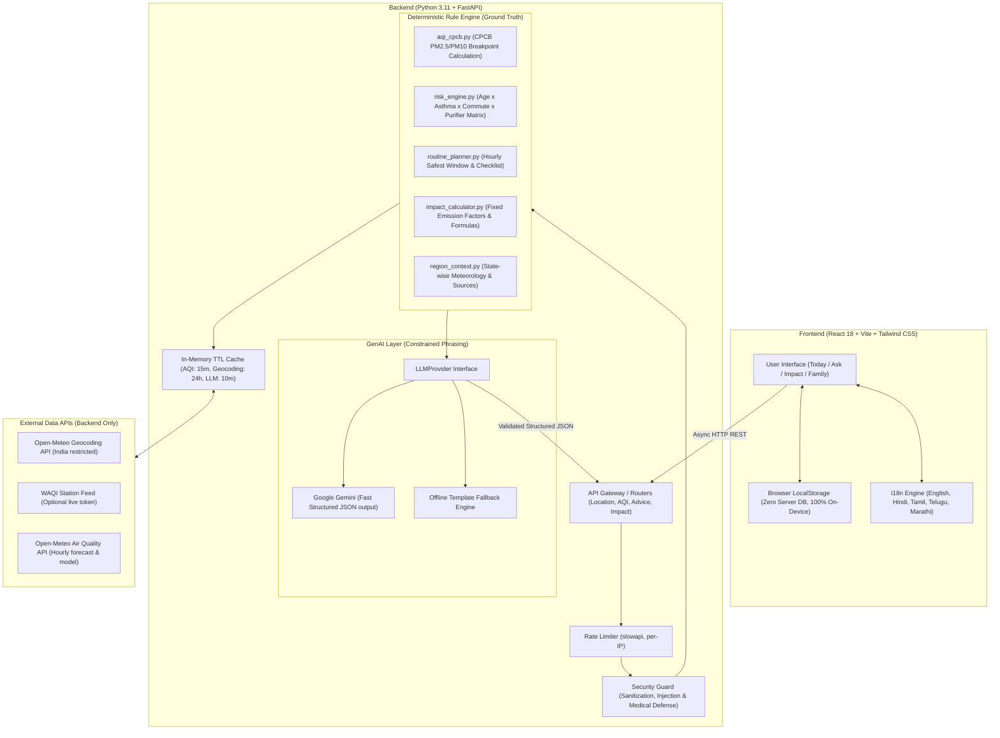

# Zephyre Architecture & System Design

## Data Flow & Invariant Principles
1. **Zero Browser Data Leaks**: All third-party endpoints and LLM keys are called exclusively by the backend service. Keys are never transmitted to clients.
2. **Local Privacy**: User profiles, names, ages, and checklist progress live solely in the client's `localStorage`. No database, no tracking pixels, and no analytics cookies.
3. **Rules First, GenAI Second**:
   - The deterministic core engine computes the ground-truth verdict (`safe`, `be_careful`, `avoid`), numeric impact, and safer windows.
   - The GenAI model is constrained to human phrasing and translation; it is architecturally prohibited from modifying verdicts or inventing emission factors.
4. **Graceful Degradation**: If network drops or the Gemini API key is absent, the backend instantly falls back to offline rule-based templates with an `is_offline_fallback=true` tag.
